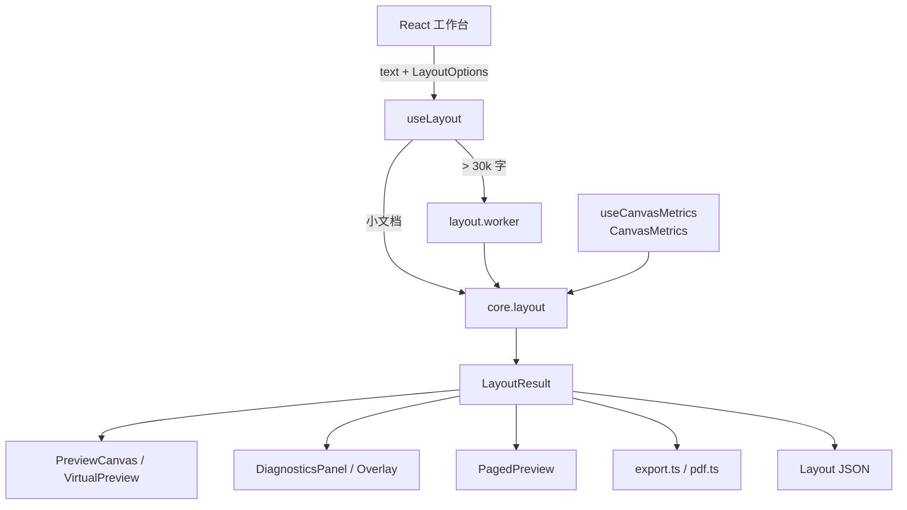

# 毕昇 · 项目学习手册

> 目标：让一个没接触过本项目的工程师，在 1–3 天内理解整体架构、核心算法、Canvas 渲染、Worker、诊断、导出与测试，并能安全地改代码。
>
> 适用版本：`master`（151 个单测）。项目地址：<https://github.com/YHL-1/bisheng-typesetting-engine>

---

## 目录

1. [先用一句话理解项目](#1-先用一句话理解项目)
2. [项目边界：它是什么，不是什么](#2-项目边界它是什么不是什么)
3. [把项目跑起来](#3-把项目跑起来)
4. [全局架构](#4-全局架构)
5. [核心数据模型](#5-核心数据模型)
6. [坐标系与行盒](#6-坐标系与行盒)
7. [从文字到 LayoutResult 的完整流水线](#7-从文字到-layoutresult-的完整流水线)
8. [规则层：禁则、挤压、混排](#8-规则层禁则挤压混排)
9. [断行算法：贪心与 Knuth-Plass](#9-断行算法贪心与-knuth-plass)
10. [行构建：makeLine](#10-行构建makeline)
11. [对齐：justifyLine](#11-对齐justifyline)
12. [诊断：diagnose](#12-诊断diagnose)
13. [分页与孤行控制](#13-分页与孤行控制)
14. [段落缓存与性能](#14-段落缓存与性能)
15. [字体度量：CanvasMetrics](#15-字体度量canvasmetrics)
16. [Canvas 渲染与 dpr](#16-canvas-渲染与-dpr)
17. [大文档：Worker 与虚拟滚动](#17-大文档worker-与虚拟滚动)
18. [React 工作台的数据流](#18-react-工作台的数据流)
19. [诊断交互与叠加层](#19-诊断交互与叠加层)
20. [A4 分页预览](#20-a4-分页预览)
21. [三栏对比与像素 diff](#21-三栏对比与像素-diff)
22. [导出：PNG / JSON / PDF](#22-导出png--json--pdf)
23. [持久化、撤销与字体上传](#23-持久化撤销与字体上传)
24. [测试体系](#24-测试体系)
25. [关键文件地图](#25-关键文件地图)
26. [推荐学习路线](#26-推荐学习路线)
27. [动手练习](#27-动手练习)
28. [调试手册](#28-调试手册)
29. [如何扩展](#29-如何扩展)
30. [设计取舍与已知限制](#30-设计取舍与已知限制)
31. [术语表](#31-术语表)
32. [FAQ](#32-faq)

---

## 1. 先用一句话理解项目

**毕昇是一个“把中文文字按规则放进固定宽度容器”的排版引擎。**

输入是一段文本 + 一组排版参数：

```ts
layout(text, options, metrics) -> LayoutResult
```

输出是**每一行、每个字的位置和宽度**，以及**为什么这样断行**的诊断数据。Canvas 只是把 `LayoutResult` 画出来；PNG/PDF/JSON 都是它的不同消费者。

最重要的设计原则：

> **排版是纯计算，渲染是副作用。**

`packages/core` 不碰 DOM、不碰 Canvas、不读 `window`。它只依赖 `Metrics` 接口拿字宽。因此同一套代码可以在：

- 浏览器主线程
- Web Worker
- Node / 测试
- 未来的服务端 PDF

里运行。

---

## 2. 项目边界：它是什么，不是什么

### 是

- 中文断行：贪心 + Knuth-Plass 风格总代价 DP
- 避头尾：关 / 基本 / 严格
- 标点挤压：行首开括号、行尾闭句读、连续标点
- 中西混排：CJK ↔ 拉丁/数字 + ¼ em
- 对齐：左 / 两端 / 居中
- 诊断：禁则 / 挤压 / 余量 / 孤行
- Canvas 预览、A4 分页、虚拟滚动
- PNG / JSON / PDF（图片版 + 实验性文字版）
- 字体上传、字重、撤销、自动保存、三栏对比

### 不是

- 不是富文本编辑器：没有加粗/斜体/图片/表格
- 不是 Word 替代品：没有分节、页眉页脚编辑、目录
- 没有后端：没有账号、文档同步、分享链接、AI
- 没有竖排/多栏/注音/悬挂标点
- 文字版 PDF 的复制/搜索仍不保证正确（ToUnicode 限制）

**学习时不要把“项目没做”误认为“代码写错了”。** 先理解它明确的产品边界。

---

## 3. 把项目跑起来

### 环境

- Node.js 22+
- pnpm 10+
- Chrome / Edge（Canvas 与字体度量）

### 命令

```bash
pnpm install
pnpm test:run          # 151 tests
pnpm --filter web lint
pnpm -r build
pnpm --filter web dev --port 5174
```

打开 <http://127.0.0.1:5174/>。

### 第一次操作

1. 左侧点「示例」
2. 拖中间纸的右边缘，观察状态栏的 `layoutMs`
3. 点「诊断」，再点正文任意一行
4. 点「对比」，看三栏 diff
5. 点「10 万字」，看 Worker + 虚拟滚动
6. 点「分页」，看 A4 页
7. 点「导出」，试 PNG / PDF / JSON

### 目录结构

```text
Typesetting-Engine/
├─ packages/
│  ├─ core/                纯 TS 排版引擎（最重要）
│  ├─ render-canvas/       Canvas 度量与绘制
├─ apps/
│  └─ web/                 React 工作台
├─ docs/progress/          截图与导出样例
├─ Plan/                  原始计划与实现手册（本地参考）
├─ ui/                    视觉稿（本地参考）
├─ README.md
├─ DEMO.md                 2 分钟演示脚本
├─ LEARNING.md             本文
├─ vercel.json / edgeone.json
└─ pnpm-workspace.yaml
```

---

## 4. 全局架构



### 依赖方向

```text
core
 ↑
render-canvas
 ↑
apps/web
```

- `core` 不知道 Canvas 存在
- `render-canvas` 依赖 core 的类型与排版结果
- `apps/web` 依赖两者

### 三层职责

| 层 | 职责 | 不该做的事 |
|---|---|---|
| core | 断行、挤压、对齐、诊断、分页 | 不读 DOM、不画图、不发请求 |
| render-canvas | 字宽测量、dpr、绘制、视口绘制 | 不改 LayoutResult |
| apps/web | 状态、交互、Worker、导出、UI | 不重新实现断行规则 |

---

## 5. 核心数据模型

全部在 `packages/core/src/types.ts`。

### Metrics

```ts
type Metrics = {
  width(ch: string): number;
  ascent: number;
  descent: number;
};
```

这是 core 与字体系统之间**唯一的契约**。core 不关心你用的是 Canvas、Node 字体库还是固定 16px。

测试里用 `createFixedMetrics(16)`：每个字宽都是 16，ascent=14.08，descent=1.92。这样断行测试完全确定。

### LayoutOptions

```ts
type LayoutOptions = {
  width: number;          // 文本宽度，不含纸张 padding
  fontFamily: string;
  fontWeight?: number;
  fontSize: number;
  lineHeight: number;     // 倍数，如 1.9
  letterSpacing: number;
  indent: number;         // 首行缩进 px
  strategy: "greedy" | "knuth-plass";
  kinsoku: "off" | "basic" | "strict";
  squeeze: boolean;
  autospace: boolean;
  align: "left" | "justify" | "center";
};
```

注意：`width` 是**文本宽度**，不是纸张宽度。工作台纸张宽度 = `width + 2 * 64`。

### Glyph / Line

```ts
type Glyph = {
  ch: string;
  x: number;   // 相对行首（含首行缩进）
  y: number;   // 基线，相对文档顶部
  w: number;   // 实际占宽（含挤压/混排）
  squeezed: boolean;
};

type Line = {
  glyphs: Glyph[];
  width: number;   // 自然宽度（未 justify）
  slack: number;   // width 容器的剩余空间
  y: number;       // 基线
  start: number;   // 归一化文本的 code-point 下标
  end: number;     // 不含
  breakReason?: BreakReason;
};
```

**不变量**（改代码时要守住）：

1. `glyphs[i].x` 是相对行首，不是相对页面
2. `line.width` 是自然宽度，justify 只改 `x`，不改 `width/slack`
3. `line.start/end` 是 code-point 下标，不是 UTF-16 code unit
4. 空行是 `glyphs: []`、`width: 0`、`slack: width`
5. `line.y` 是基线，不是行顶

### BreakReason

```ts
type BreakReason = {
  candidates: number[];   // 候选断点（code-point）
  chosen: number;         // 实际断点
  cost: number;           // 诊断归一化代价；KP 保留搜索代价
  costParts?: {
    slack: number;
    squeeze: number;
    kinsoku: number;
    overflow: number;
  };
  blockedBy?: "kinsoku-start" | "kinsoku-end" | "overflow" | "word";
  blockedAt?: number;     // 导致前移/硬断的字符下标
};
```

`blockedAt` 是 D5 加的：只有 `blockedBy` 时，面板会把「在」误当成被拦下的「。」；加上下标后才能显示正确字符。

### Diagnostic / LayoutResult

```ts
type Diagnostic = {
  line: number;
  type: "kinsoku" | "squeeze" | "slack" | "orphan";
  detail: string;
};

type LayoutResult = {
  lines: Line[];
  height: number;          // lines.length * lineBox
  diagnostics: Diagnostic[];
};
```

`height` 不含纸张 padding，也不含页眉页脚。

---

## 6. 坐标系与行盒

这是读代码最容易混的地方。

### 单位

- 布局单位：**CSS px**
- Canvas backing store：CSS × dpr，向上取整
- PDF：pt（A4 595.28 × 841.89）

### 行盒

```text
line box top
  ┌──────────────────────────────┐
  │ half leading                 │
  │  ┌────────────────────────┐  │
  │  │ ascent                 │  │
  │  │ ─────── baseline ───── │  │  ← glyph.y
  │  │ descent                │  │
  │  └────────────────────────┘  │
  │ half leading                 │
  └──────────────────────────────┘
```

公式（`typography.ts`）：

```ts
lineBoxHeight = fontSize * lineHeight;
halfLeading  = (lineBoxHeight - fontSize) / 2;
firstBaseline = halfLeading + metrics.ascent;
```

默认值（16px / 1.9 / ascent 0.88em）：

```text
lineBox     = 30.4
halfLeading = 7.2
ascent      = 14.08
descent     = 3.52
firstBaseline = 21.28
第 n 行基线 = firstBaseline + n * lineBox
```

所以 `line.y` 是基线，`line.y - firstBaseline` 才是行顶。

### 渲染时

`drawLayout` 直接：

```ts
ctx.textBaseline = "alphabetic";
ctx.fillText(glyph.ch, glyph.x, line.y);
```

因为 `line.y` 已经是基线。

---

## 7. 从文字到 LayoutResult 的完整流水线

```mermaid
flowchart LR
  A[原始文本] --> B[CRLF 归一化]
  B --> C[split('\\n')]
  C --> D[逐段]
  D --> E[段落缓存]
  E -->|miss| F[贪心 / KP]
  F --> G[makeLine: 挤压 + 混排]
  G --> H[justifyLine]
  H --> I[堆叠 y / 全局 offset]
  I --> J[diagnose]
  J --> K[LayoutResult]
```

入口：`packages/core/src/layout.ts` 的 `layout()`。

### 步骤 1：归一化

```ts
const normalized = text.replace(/\r\n?/g, "\n");
```

CRLF 和 CR 都变成 LF，保证 `Line.start/end` 与编辑器看到的文本一致。

### 步骤 2：切段

```ts
const segments = normalized.split("\n");
```

注意：**这里每个 `\n` 都切一段**。所以：

- `"第一段\n第二段"` 在引擎里是 2 个段落 → 两段都有首行缩进
- 工作台的「段」用 `countParagraphs`，按**空行**分段，所以显示 12 段，但引擎可能切出更多段

这是两个不同概念：

| 概念 | 函数 | 分隔 |
|---|---|---|
| 引擎段落 | `normalized.split("\n")` | 每个换行 |
| UI 段落 | `countParagraphs` | 一个或多个空行 |

学习时以 `layout()` 的切段为准。

### 步骤 3：空行与尾换行

```ts
if (isLast && segment.length === 0 && normalized.endsWith("\n")) break;
```

- 文末换行不额外生成空行
- 中间连续换行会保留空行
- 空行生成 `glyphs: []` 的 Line

### 步骤 4：段落缓存

`rawParagraphLines()` 先查缓存。key 包含：

```text
offset | firstLine | metricsId | breakSignature | segment
```

- `offset/firstLine`：同样的文字放在不同位置，行号/offset 不同
- `metricsId`：字体/字号/字重换了，度量对象就换了
- `breakSignature`：width/font/lineHeight/letterSpacing/indent/strategy/kinsoku/squeeze/autospace
- **不包含 `align`**：对齐变化不需要重新断行

### 步骤 5：断行 + 行构建

缓存 miss 时调用：

- `layoutGreedy()` 或
- `layoutKnuthPlass()`

两者都返回**未 justify** 的 Line（但已经完成挤压/混排）。

### 步骤 6：justify

```ts
paragraphLines.forEach((line, index) => {
  justifyLine(line, opts, index === paragraphLines.length - 1);
});
```

对齐是**每次调用都重新做**的；缓存只缓存断行/挤压结果。

### 步骤 7：堆叠

断行函数接收 `{ offset, firstLine }`，直接在 `makeLine` 里设置全局 `start/end/y`；空行由 `layout()` 自己补。

### 步骤 8：代价拆分 + 诊断

所有行完成后：

1. 填 `breakReason.costParts`
2. 调用 `diagnose(result, normalized, opts)`

诊断只读结果，不重新断行。

---

## 8. 规则层：禁则、挤压、混排

文件：`packages/core/src/rules.ts`。

### 禁则表

```ts
KINSOKU_START = ，。、；：？！）〕〉》」』】”’·…—～%‰℃
KINSOKU_END   = （〔〈《「『【“‘
```

命名容易反：

- `KINSOKU_START` = **不能出现在行首**的字
- `KINSOKU_END` = **不能出现在行尾**的字

`isOpeningPunct` 实际返回 `KINSOKU_END`（开括号不能留在行尾），`isClosingPunct` 返回 `KINSOKU_START`（闭句读不能出现在行首）。读代码时看注释，不要只看函数名。

### `canBreakBetween(prev, next, level)`

```ts
off:    永远可以
basic:  next 是禁则首字 → false
        prev 是禁则尾字 → false
strict: basic + prev/next 都是拉丁/数字 → false
```

这是断行合法性的唯一入口。新增规则优先改这里，而不是在两个断行算法里各写一遍。

### `glyphWidth`

这是全项目最细的一个函数：

```ts
w = metrics.width(ch)
```

1. **autospace**（如果开启）
   - 只在 CJK ↔ 拉丁/数字边界
   - 加 **0.25em**
   - 加在**左边那个字**上
   - 标点不参与
2. **squeeze**（如果开启）
   - 只对 `isPunct(ch)` 生效
   - 条件：连续标点 / 行首开括号 / 行尾闭句读
   - `w *= 0.5`

为什么混排加在左边？

```text
中 A
  ^ 这个 ¼ em 属于「中」和「A」之间的边界
```

如果加在当前字 `A` 上，gap 会跑到 A 后面，晚一个字。这是经典的 off-by-one。

### 行首/行尾挤压

`glyphWidth` 接收 `isLineStart`、`isLineEnd`：

- 行首开括号 `（` → 半角
- 行尾闭句读 `。` → 半角
- 连续标点 `。」` → 每个都半角，整体约 1em

### 为什么断行时关闭 squeeze？

`layoutGreedy`：

```ts
const breakOpts = opts.squeeze ? { ...opts, squeeze: false } : opts;
```

断行时用**未挤压宽度**决定断点，`makeLine` 才应用挤压。

原因：如果边断边挤，可能“挤一下能多放一个字 → 断点变化 → 新行又能挤 → 振荡”。先断后挤保证**开关挤压不改变行数**，只改行宽、余量和标点占宽。

代价：可能比“挤了再断”少放一个字。这是项目明确选择的稳定性。

---

## 9. 断行算法：贪心与 Knuth-Plass

文件：`packages/core/src/break.ts`。

### 9.1 贪心 `layoutGreedy`

核心循环（简化）：

```ts
while (start < chars.length) {
  let width = firstLine ? indent : 0;
  let lastBreak = -1;
  const candidates = [];

  for (index = start; index < chars.length; index++) {
    const measured = glyphWidth(ch, prev, next, index===start, false, breakOpts, metrics);
    const advance = index > start ? measured.w + letterSpacing : measured.w;

    if (width + advance > opts.width) break;
    width += advance;

    if (next !== null && canBreakBetween(ch, next, kinsoku)) {
      candidates.push(index + 1);
      lastBreak = index + 1;
    }
  }

  end = lastBreak > start ? lastBreak : hardBreak(index);
  makeLine(...);
  start = end;
}
```

关键点：

- `next` 参与宽度计算：为了给混排 ¼ em 预留空间
- `lastBreak` 记录最后一个合法断点
- 溢出时，如果之前有合法断点，就回退到 `lastBreak`
- 如果没有任何合法断点（比如一行全是标点），硬断在溢出点
- `end <= start` 时强制 `end = start + 1`，保证一定前进

### `blockedBy / blockedAt` 怎么来

如果 `end < index`（断点比溢出点早），说明某个规则拒绝了更晚的断点：

```text
next 是禁则首字   → kinsoku-start，blockedAt = index
prev 是禁则尾字   → kinsoku-end，  blockedAt = index - 1
prev/next 都是拉丁 → word
否则              → overflow
```

例：

```text
宽度只够到「存」
下一个是「在」，再下一个是「。」
断点不能在「。」前（禁则首字）
所以断在「存」后
blockedBy = kinsoku-start
blockedAt = 「。」的下标
chosen = 「存」后的下标
```

这就是诊断面板能说清“为什么断在这”的原因。

### 9.2 Knuth-Plass `layoutKnuthPlass`

项目实现的是**有界总代价 DP**，不是 TeX 完整的三向模型。

状态：

```ts
best[i]     = 从 0 到 i 的最小累计代价
previous[i] = 最优前驱断点
```

对每个可达的 `start`，向后扫描，遇到合法断点 `end` 就算一条边：

```text
badness = (slack / stretch)^3 * 100
stretch = max(1, gaps) * fontSize * 0.5
cost    = best[start] + badness
```

规则：

- 最后一行 `badness = 0`（末行不 justify）
- 负 slack 给高惩罚
- 超过 `width + 0.75em` 停止
- 如果从某个 start 一条合法边都没有，加一条 `hardEnd` 边，代价 10000
- 回溯 `previous` 得到断点序列
- 回溯失败则回退贪心

与贪心区别：

| | 贪心 | KP |
|---|---|---|
| 决策 | 每行局部最优 | 全文累计代价 |
| 速度 | 快 | 慢（但本项目有界） |
| 末行 | 不管 | 免罚 |
| 行数 | 可能多 | 通常更均匀 |
| 适用 | 实时拖宽 | 定稿/对比 |

**注意**：本项目 KP 的 `candidates` 只记录 chosen 一个，不是所有候选；诊断面板的“候选”主要来自贪心。

---

## 10. 行构建：makeLine

`makeLine(chars, start, end, ...)` 负责把字符区间变成 `Glyph[]`。

```ts
let x = indent;

for (index = start; index < end; index++) {
  const measured = glyphWidth(
    ch,
    index > start ? chars[index-1] : null,
    index < end - 1 ? chars[index+1] : null,
    index === start,
    index === end - 1,
    opts,
    metrics,
  );

  glyphs.push({ ch, x, y: baseline, w: measured.w, squeezed: measured.squeezed });

  x += index < end - 1
    ? measured.w + letterSpacing
    : measured.w;
}
```

细节：

- `indent` 只加在第一行
- 最后一个字不加 `letterSpacing`
- `width = x`，包含首行缩进
- `slack = opts.width - x`

### 为什么断行时 `isLineEnd=false`

断行阶段还不知道最终行尾，所以用 `false`；`makeLine` 拿到最终 `end` 后再用 `true` 判断行尾闭句读挤压。

### 最后一行混排

断行时最后一个字的 `next` 可能是下一段的字，会预留 ¼ em；`makeLine` 里最后字 `next=null`，混排间距被丢掉，所以行只会更窄，不会溢出。

---

## 11. 对齐：justifyLine

文件：`packages/core/src/justify.ts`。

### 三种模式

- `left`：直接返回，不改 x
- `center`：所有 glyph `x += slack/2`
- `justify`：
  - 段落末行不拉伸
  - 只拉伸“可拉伸 gap”
  - gap > 0.5em 时降级左对齐

### 拉丁单词保护

```ts
stretchable[i] = !(isLatin(left.ch) && isLatin(right.ch));
```

也就是说：

```text
中 h e l l o 中
↑           ↑
可拉伸      可拉伸
  h-e/e-l/l-l/l-o 都不可拉伸
```

不会出现 `h e l l o` 被撕开。

### 余量分配

```ts
extra = slack / stretchCount;
if (extra > fontSize * 0.5) return { applied:false, fallback:"gap" };
```

`Line.width` 和 `slack` 不变，只改 `glyph.x`。所以：

- 诊断看到的 `line.slack` 是自然余量
- 视觉上的行宽是 `opts.width`
- 导出 JSON 里的 `width` 仍是自然宽度

### 一个细微不一致

`diagnose()` 计算 fallback 时用的是 `slack / gaps`（全部 gap），而 `justifyLine()` 用的是 `slack / stretchCount`（排除拉丁内部 gap）。读代码时留意：如果一行拉丁词很多，诊断的 fallback 判断可能和实际 justify 不完全一致。改这块时两边要同步。

---

## 12. 诊断：diagnose

文件：`packages/core/src/diagnostics.ts`。

诊断是**后处理**：只读 `LayoutResult`，不重新断行。

### 四类

| 类型 | 触发条件 | 说明 |
|---|---|---|
| `kinsoku` | `blockedBy` 是 kinsoku-* | 断点因禁则前移 |
| `squeeze` | 行内有 `squeezed` 字 | 标点被压到半角 |
| `slack` | justify fallback，或非末行余量 >20% | 行太松 |
| `orphan` | 段末行宽度 <25%，且该段多于 1 行 | 孤行/寡行 |

### 空行处理

```ts
if (line.glyphs.length === 0) {
  paragraphLines = 0;
  continue;
}
```

空行把 `paragraphLines` 归零，所以孤行判断只在段内有效。

### 代价拆分

`layout.ts` 在所有行完成后填：

```ts
costParts = {
  slack:   max(0, line.slack) / opts.width,
  squeeze: 有挤压 ? 0.5 : 0,
  kinsoku: 禁则 ? 0.01 : 0,
  overflow: 硬断 ? 0.5 : 0,
};
reason.cost = 贪心 ? sum(costParts) : KP 搜索代价;
```

诊断面板用它画堆叠条。

### 注意

`slack` 诊断在 justify 开启且成功时**不会报**，因为那行的 slack 已经被视觉拉伸填满。所以在默认两端对齐下，“余量 >20%”通常会看到 0 处；切到左对齐或触发 fallback 才会出现。

---

## 13. 分页与孤行控制

文件：`packages/core/src/pagination.ts`。

### capacity

```ts
pageCapacity(pageHeight, lineBox) =
  max(1, floor(pageHeight / lineBox) - 1);
```

减 1 是给 widow 控制留一行余量。

### 分页

```ts
pages = chunk(lines, capacity)

for page in 1..pages.length-1:
  if page 第一行是段末行
     and 上一页行数 > 1:
       把上一页最后一行移到本页开头
```

这叫 **widow control（孤行控制）**：避免一段的最后一行单独出现在新页顶部。

注意本项目实现是“把上一页最后一行拉过来”，不是“把段末行拉回上一页”；效果都是让新页至少有两行同段。

### A4 参数

`apps/web/src/lib/pdf.ts`：

```ts
A4_WIDTH = 595.28
A4_HEIGHT = 841.89
PAGE_MARGIN = 36
CONTENT_WIDTH = 523.28
CONTENT_HEIGHT = 769.89

pageHeightCss = CONTENT_HEIGHT / (CONTENT_WIDTH / options.width)
```

所以 PDF 的 592px 文本会缩放到 523.28pt 内容宽度。

---

## 14. 段落缓存与性能

文件：`packages/core/src/layout.ts`。

### 为什么需要

拖宽时每次 `layout()` 都重排 3k 字。如果没有缓存，每帧都要重新断行；有了缓存，**只改对齐**时可以复用断行结果。

### key

```text
offset | firstLine | metricsId | breakSignature | segment
```

`breakSignature` **不包含 align**，所以：

- 切左/两端/居中 → 命中缓存，只重新 justify
- 改宽度/字体/字号/行高/禁则/挤压/混排 → miss
- 改某一段文字 → 该段 miss；如果行数变化导致后续 offset/firstLine 变化，后续也会 miss

### 缓存值

缓存的是 `cloneLines(raw)`，即**未 justify 的原始行**。

- miss：缓存 clone，返回 raw；调用方 justify 修改 raw，不会污染缓存
- hit：clone 缓存，再 justify

### 容量

`PARAGRAPH_CACHE_LIMIT = 128`，简单 FIFO 淘汰（Map 插入顺序）。

### 统计

```ts
clearLayoutCache()
getLayoutCacheStats() // { hits, misses, size }
```

测试 `layout-cache.test.ts` 用它证明：

- 重复 layout 第二次全命中
- 只改 align 时 0 miss
- 只改一段文字时只 miss 那段
- 改宽度时全部 miss

### 性能数据

- 3,014 字热态：0.6–0.9ms
- 首次：~105ms（主要是一次性 measureText 缓存填充）
- 100k 全 `中`：~50ms
- 100k 复杂多段：~440ms

---

## 15. 字体度量：CanvasMetrics

文件：`packages/render-canvas/src/metrics.ts`。

### 最大的坑

```ts
ctx.font = "Noto Serif SC";   // ❌ 没有 px
```

浏览器会**忽略**这个赋值，context 保持默认 10px 字体。之后所有 `measureText` 都错，但不会报错。

所以：

```ts
ctx.font = "16px \"Noto Serif SC\"";
```

`createCanvasMetrics(font)` 用 `assertFontShorthand` 检查必须含 `px`。

### 缓存

```ts
const cache = new Map<string, number>();
```

按字符缓存。`stats` 记录 reads/hits/misses/hitRate/uniqueGlyphs。

### 空格兜底

有些字体 `measureText(" ")` 返回 0。此时用：

```ts
space = measure("中 中") - 2 * measure("中")
```

### ascent/descent

```ts
probe = ctx.measureText("中");
ascent = probe.actualBoundingBoxAscent || fontSize * 0.88;
descent = probe.actualBoundingBoxDescent || fontSize * 0.22;
```

注意 core 的 `FixedMetrics` 用 0.88/0.12；Canvas 用 0.88/0.22。测试与浏览器会有细微差异。

### 自检

```ts
verifyGlyphWidth(metrics, font, "汉")
```

重新 `measureText` 一次，和缓存值比较；`delta < 1e-6` 才算一致。状态栏的「度量校验 Δ0.00px」就是它。

### useCanvasMetrics

`apps/web/src/hooks/useCanvasMetrics.ts`：

1. `loadFont(fontSpec)` 等 `document.fonts.ready`
2. `createCanvasMetrics(fontSpec)`
3. `verifyGlyphWidth`
4. `document.fonts.check(probe)` 判断是否 fallback
5. 监听 `document.fonts.loadingdone`，字体晚到会重建 metrics

在字体切换期间，旧 metrics 会被隐藏（`state.key !== fontSpec`），避免“用 A 字体量、用 B 字体画”。

---

## 16. Canvas 渲染与 dpr

文件：`packages/render-canvas/src/dpr.ts`、`draw.ts`。

### dpr

```ts
normalizeDpr(dpr) = clamp(dpr, 0.5, 4)
backingWidth = ceil(cssWidth * dpr)
```

### prepareCanvas

```ts
canvas.width = size.width;
canvas.height = size.height;
canvas.style.width = `${size.cssWidth}px`;
canvas.style.height = `${size.cssHeight}px`;

ctx.setTransform(size.dpr, 0, 0, size.dpr, 0, 0);
ctx.clearRect(0, 0, size.cssWidth, size.cssHeight);
ctx.font = fontString(...);
ctx.textBaseline = "alphabetic";
```

关键：用 `setTransform`，不要用 `ctx.scale(dpr,dpr)`。后者在重复绘制时会累乘，第二次变成 dpr²。

### drawLayout

- `cssHeight` 默认 `layout.height`
- 可选 `background`：先铺白底再画字（PNG/PDF 用）
- 遍历所有 line，`ctx.fillText(glyph.ch, glyph.x, line.y)`
- `showGlyphWidths`：第二遍画每条字宽线，能看到挤压（短线）和混排（长线）

### drawLayoutViewport

用于 10 万字虚拟滚动：

```ts
y = line.y - scrollTop;
if (y < -margin || y > viewportHeight + margin) continue;
ctx.fillText(glyph.ch, glyph.x, y);
```

只画可见行，但保留文档坐标。

### drawSingleLine

D1 遗留调试函数，工作台已不用；读代码时可以跳过。

---

## 17. 大文档：Worker 与虚拟滚动

### 阈值

`useLayout.ts`：

```ts
const LARGE_TEXT = 30_000;
const large = text.length > LARGE_TEXT;
```

注意是 **UTF-16 code unit** 的 `text.length`，不是 code point。

### 小文档

```ts
const main = useMemo(() => measureLayout(text, options, metrics), ...);
```

主线程直接排版。`measureLayout` 用 `performance.now()` 包住 `layout`，状态栏显示真实耗时。

### 大文档

```ts
const widths = {};
for (const ch of new Set(Array.from(text))) widths[ch] = metrics.width(ch);

const worker = new Worker(new URL("../workers/layout.worker.ts", import.meta.url), {
  type: "module",
});
worker.postMessage({ text, options, widths, ascent, descent });
```

Worker 不能直接拿 CanvasMetrics（不可序列化），所以主线程先建**字符 → 宽度表**传过去。Worker 里构造一个最小 Metrics：

```ts
const metrics = {
  width: (ch) => widths[ch] ?? 0,
  ascent,
  descent,
};
```

### Worker 内部分段

`layout.worker.ts` 的 `layoutIncrementally`：

- 按 `\n` 切段
- 每段调用一次 `layout(segment, options, metrics)`
- 把 `line.y/glyph.y` 平移 `lines.length * lineBox`
- 把 `line.start/end/breakReason` 平移 `offset`
- 把 diagnostics 行号平移 `firstLine`
- 每 8 段 `postMessage(progress)` 并 `setTimeout(0)` 让出事件循环

这样 `layout()` 可以复用段落缓存和全部规则，同时 Worker 能报进度。

### 虚拟滚动

`VirtualPreview.tsx`：

- 外层 `.virtual-viewport` 高度 520，`overflow-y:auto`
- 内层 `.virtual-paper` 高度 = `layout.height`，撑出滚动条
- `.virtual-sticky` `position:sticky; top:0`，里面放 canvas
- scroll 事件用 rAF 合并，setState 后重绘
- 只画视口附近的行

行号：

- `.virtual-line-numbers` 绝对定位在左侧 gutter
- 只渲染可见行
- `.virtual-viewport` 用 `padding-left:36px` + 负 margin 扩展进纸张 padding，避免被 `overflow-x:hidden` 裁掉

诊断：

- `DiagnosticOverlay` 接收 `scrollTop`
- `top = line.y - firstBaseline - scrollTop`
- 只画可见行
- 点击时 `index = floor((clientY - rect.top + scrollTop) / lineBox)`

### 进度/取消的边界

Worker 进度消息确实逐段回传，但 10 万字 `<textarea value>` 的受控更新会占用主线程，所以 UI 可能只在后段看到百分比。Esc 取消仍可用；这不是 Worker 的问题，是 textarea 渲染的瓶颈。

---

## 18. React 工作台的数据流

### App 状态

`App.tsx` 主要 state：

```ts
text              // 编辑文本
rules             // 规则（width/font/strategy/align/...）
layout            // 来自 useLayout
diagnosticsOpen   // 诊断面板
selectedLine      // 当前行
ignoredTypes      // 被忽略的诊断类型
mode              // edit | compare
uploadedFont      // 上传字体 + bytes
historyRef        // 撤销栈
```

### 选项映射

```ts
options = {
  ...DEFAULT_LAYOUT_OPTIONS,
  width: rules.width,
  fontFamily: font.family,
  fontWeight: rules.fontWeight,
  ...
  indent: Math.round(rules.indentChars * rules.fontSize),
}
```

注意 `indentChars` 是 UI 的“字”，`indent` 是 px。

### 数据流

```text
textarea onChange
  → commitText
  → setText
  → options useMemo
  → useLayout
  → layout
  → Stage / Diagnostics / StatusBar / export
```

### 两条路径

```text
text.length <= 30k  ->  measureLayout 主线程
text.length > 30k   ->  Worker -> progress -> layout
```

### 重新排版

`handleRelayout` 只 `setRedrawKey(key+1)`，Stage 把它传给 `PreviewCanvas` 触发重绘。它**不会**重新跑 layout（输入没变，结果确定）。真正改规则/文本会触发 `useLayout`。

### 撤销

- `historyRef.past/future` 存**文本快照**
- 最多 30 条
- 只撤销文本，不撤销规则
- Ctrl+Z / Ctrl+Shift+Z / Ctrl+Y
- `historyState` 只存 canUndo/canRedo，避免 render 读 ref

### 自动保存

`session.ts`：

```ts
KEY = "bisheng.session.v1"
loadSession() / saveSession({ text, rules })
```

`useEffect` 350ms debounce。字体二进制不保存。

---

## 19. 诊断交互与叠加层

### 打开

`toggleDiagnostics` → `openDiagnostics`：

```ts
setDiagnosticsOpen(true);
setSelectedLine(layout.diagnostics[0]?.line ?? 0);
```

### 叠加层

`DiagnosticOverlay.tsx`：

- 第二层 canvas，绝对定位在文本 canvas 上
- 选中行：填充 + 边框
- `kinsoku`：行首红色三角
- `squeeze`：行内短横线
- `slack`：行末琥珀色竖条
- `orphan`：行首青色圆点

点击：

```ts
const index = Math.floor((event.clientY - rect.top + scrollTop) / lineBox);
onSelectLine(index);
```

### 面板

`DiagnosticsPanel.tsx`：

- 当前行 / 总行
- 断点 chosen
- 候选（最后 6 个）
- 代价 + costParts 堆叠条
- blockedBy/blockedAt 文案
- 上一处/下一处
- 候选断点卡片
- 全部标记（按类型计数 + 行号）
- 忽略/恢复类型
- 统计
- 导出 JSON / 返回规则

`ignoredTypes` 同时传给面板和叠加层，保证“忽略”是真过滤。

---

## 20. A4 分页预览

`PagedPreview.tsx`：

```ts
pageHeight = pdfPageHeight(options)
capacity = pageCapacity(pageHeight, lineBox)
pages = paginateLines(layout.lines, capacity, chars)
```

每个 `PageCanvas`：

1. 取该页 lines
2. `pageTop = 第一行.y - firstBaseline`
3. 所有 `line.y/glyph.y -= pageTop`
4. `drawLayout` 到 `pageHeight` 高的 canvas
5. 外层 `.page-sheet` 显示页眉/页脚/页码

分页预览和 PDF 共用 `pdfPageHeight` / `paginateLines`，所以页数和分页结果一致。

---

## 21. 三栏对比与像素 diff

`Compare.tsx`：

- 三栏固定 384px 文本宽
- 浏览器栏：DOM `text-align: justify`
- 毕昇栏：Canvas
- 导出栏：Canvas + 白底
- 只支持 <= 3 万字

### diff

```ts
const primary = render();   // 毕昇
const exported = render();  // 导出路径
getImageData 后逐像素比较
```

两者都走同一个 `drawLayout`，所以 diff 为 0。它证明的是“导出路径和预览路径的文字层一致”，不是“和浏览器一致”。

> 注意：这个 diff 是同一实现的两次渲染，严格说是“一致性检查”，不是和外部基准的对比。

---

## 22. 导出：PNG / JSON / PDF

### PNG

`export.ts`：

- 1x/2x/3x
- 单边上限 16,384
- 超过则按**行边界**分片，每片一个下载
- 白底（`background:"#ffffff"`）
- 文件名：`bisheng-{width}x{height}@{scale}x[-partNN].png`

### JSON

```ts
{
  text,
  options,
  lines,
  diagnostics,
  height
}
```

这是学习/调试最有用的产物：能看到每个 glyph 的 x/y/w。

### 图片版 PDF

`pdf.ts` `exportPdf`：

1. A4 + 36pt 边距
2. `pdfPageHeight` 算 CSS 页高
3. `paginateLines` 分页
4. 每页 `renderLayoutToCanvas` 2x
5. `pdf.embedPng` + `drawImage`
6. 文字不可选

### 文字版 PDF（实验性）

`exportTextPdf`：

- 动态加载 `pdf-lib` + `@pdf-lib/fontkit`
- 上传的 TTF/OTF 嵌入
- 按行 `drawText`
- **ToUnicode 不完整**：pypdf/PyMuPDF 抽取中文会乱码
- 入口已标“实验性”，复制/搜索不保证

不要把它当作“文字 PDF 已完成”。

---

## 23. 持久化、撤销与字体上传

### localStorage

```ts
KEY = "bisheng.session.v1"
{ text, rules }
```

- 350ms debounce
- 刷新恢复
- 5MB 级别；100k 文本约 200KB
- 不上传服务器

### 字体上传

`handleUploadFont`：

1. `file.arrayBuffer()`
2. `new FontFace(family, bytes)`
3. `await face.load()`
4. `document.fonts.add(face)`
5. 存入 `uploadedFont`（含 bytes）
6. `rules.fontId = "uploaded"`

字体只在内存；刷新后要重传。文字版 PDF 需要这份 bytes。

### 字重

`fontString(size, family, weight)` → `400 16px "..."`。`useCanvasMetrics` 的 key 包含 weight。

---

## 24. 测试体系

### 命令

```bash
pnpm test          # watch
pnpm test:run      # 151 tests
pnpm --filter web lint
pnpm -r build
```

### 测试文件

`packages/core/test/`：

- `typography`：行盒/基线
- `rules`：禁则表/断行合法性
- `glyph-width`：挤压/混排
- `spacing`：混排边界
- `justify`：三种对齐/拉丁保护
- `layout`：切段/空行/禁则/硬断
- `knuth-plass`：覆盖/不拆词/全标点/代价
- `diagnostics`：四类
- `pagination`：容量/孤行
- `layout-cache`：命中/脏段
- `purity`：core 不碰 DOM
- `defaults` / `metrics` / `text`

`packages/render-canvas/test/`：

- `dpr`：尺寸/归一化
- `metrics`：字体 shorthand 守卫
- `font`：fontString / 可用性

### 测试策略

- core 用 `FixedMetrics(16)`，不依赖浏览器
- 不测像素（没有视觉回归）
- 浏览器验收靠临时 CDP 脚本，不在仓库
- 所以：**改渲染相关代码要手动跑预览**

---

## 25. 关键文件地图

| 想改什么 | 先看 |
|---|---|
| 字宽/挤压/混排 | `rules.ts` |
| 断行 | `break.ts` |
| 对齐 | `justify.ts` |
| 诊断 | `diagnostics.ts` |
| 段落/缓存 | `layout.ts` |
| 分页 | `pagination.ts` |
| 字体度量 | `render-canvas/metrics.ts` |
| Canvas 绘制 | `render-canvas/draw.ts` |
| dpr | `render-canvas/dpr.ts` |
| 工作台状态 | `App.tsx` |
| 大文档 | `useLayout.ts` + `layout.worker.ts` + `VirtualPreview.tsx` |
| 诊断 UI | `DiagnosticOverlay.tsx` + `DiagnosticsPanel.tsx` |
| A4 | `PagedPreview.tsx` + `lib/pdf.ts` |
| 对比 | `Compare.tsx` |
| 导出 | `lib/export.ts` + `lib/pdf.ts` |
| 持久化 | `lib/session.ts` |

---

## 26. 推荐学习路线

### 第 1 天：能跑、能读

1. 跑测试，打开工作台
2. 读 `README.md` + 本文第 1–7 节
3. 读 `types.ts`、`typography.ts`
4. 点一次「导出 JSON」，对照 `Line/Glyph` 字段
5. 读 `layout.test.ts`，理解输入输出

### 第 2 天：核心算法

按顺序读：

```text
rules.ts
  → break.ts (先 layoutGreedy，再 layoutKnuthPlass)
  → justify.ts
  → layout.ts
  → diagnostics.ts
  → pagination.ts
```

每读一个函数，跑对应测试：

```bash
pnpm vitest run packages/core/test/rules.test.ts
pnpm vitest run packages/core/test/glyph-width.test.ts
pnpm vitest run packages/core/test/layout.test.ts
```

### 第 3 天：渲染与工作台

```text
render-canvas/metrics.ts
  → dpr.ts
  → draw.ts
  → useCanvasMetrics.ts
  → useLayout.ts
  → Stage.tsx
  → VirtualPreview.tsx
  → App.tsx
```

### 第 4 天：导出与交互

```text
DiagnosticOverlay.tsx
  → DiagnosticsPanel.tsx
  → PagedPreview.tsx
  → Compare.tsx
  → export.ts
  → pdf.ts
  → session.ts
```

---

## 27. 动手练习

### 练习 1：追一行

输入：

```text
中文，中文
```

width=100，fontSize=16，indent=0，strict。

手工算：

- 每个字宽 16
- 第 1 行能放几个？
- 断点候选有哪些？
- 为什么不能在 `，` 前断？

然后写一个临时测试打印 `layout().lines[0].breakReason`。

### 练习 2：加一个禁则字

在 `KINSOKU_START` 加 `"→"`，跑 `rules`/`layout` 测试，观察哪些用例变化。

### 练习 3：改混排

把 `glyphWidth` 里的 `0.25` 改成 `0.2`，跑 `spacing`/`glyph-width` 测试，理解为什么测试会失败。

### 练习 4：加一个诊断类型

在 `Diagnostic` 加 `"widow"`，在 `diagnose` 里构造条件，在面板 `TYPE_LABEL` 加文案，跑测试。

### 练习 5：让 KP 记录更多候选

当前 KP 的 `candidates` 只有 chosen。尝试在 DP 时把每一行的候选断点存下来，观察面板变化。

### 练习 6：修 diagnose 的 fallback

让 `diagnose` 的 `extra` 使用和 `justifyLine` 一样的 `stretchable gaps`，补一个测试。

### 练习 7：加一个导出格式

在 `TopBar` 加一个“导出纯文本行”菜单项，在 `App.handleExport` 里实现，理解导出菜单的数据流。

---

## 28. 调试手册

### 字宽不对

1. 看状态栏「度量校验 Δ」
2. 检查 `fontString` 是否包含 `px`
3. 检查字体是否真的加载：`document.fonts.check(...)`
4. 检查是否 fallback
5. 硬刷新，Worker 可能缓存旧代码

### 行数不对

1. 看 `options.width` 是否含 padding（应只文本宽度）
2. 看 `indent` 是否重复加
3. 看 `breakOpts` 是否误开 squeeze
4. 看 `next` 混排是否多算
5. 对比 `layout.test.ts` 的固定 metrics

### 开关挤压行数变了

不应该。检查断行是否用了 `breakOpts`（squeeze=false）；`makeLine` 才应开 squeeze。

### 行首标点

1. 该字是否在 `KINSOKU_START`
2. `canBreakBetween` 是否被调用
3. 是否无合法断点，硬断导致（全标点行会出现）
4. 是否 `blockedAt` 指错

### 混排间距晚一个字

检查 `glyphWidth` 是否把 ¼ em 加在 `next` 边界对应的**左字**上。

### 诊断面板“被拦字”不对

检查 `BreakReason.blockedAt`，不要用 `chosen` 去查字符。

### Worker 没进度

1. 文本是否 >30k
2. 是否只有一个段落（100k 全 `中` 只有一段）
3. textarea 是否阻塞主线程
4. Worker 是否报错回退（console `[bisheng] worker failed`）

### 虚拟行号不见

1. `.virtual-viewport` 是否有 36px 左 gutter
2. `overflow-x` 是否裁掉
3. `.virtual-line-numbers` 的 `left`

### A4 空白/页数不对

1. `pdfPageHeight` 是否用 content 尺寸
2. `pageCapacity` 是否减 1
3. `paginateLines` 是否收到 chars
4. `PageCanvas` 是否 shift y

### 文字版 PDF 复制乱码

这是 ToUnicode 限制，不是字体没嵌入；用图片版 PDF。

### 刷新后字体没了

预期行为：字体二进制不持久化；重新上传。

### 本地状态脏了

DevTools → Application → Local Storage → 删除 `bisheng.session.v1`，刷新。

---

## 29. 如何扩展

### 加一条断行规则

1. 在 `rules.ts` 的 `canBreakBetween` 加约束
2. 在 `break.ts` 的 `blockedBy` 类型/诊断文案加分支
3. 加 `rules.test.ts` / `layout.test.ts`
4. 跑全量测试

### 加一种对齐

1. `LayoutOptions.align` 加 union
2. `justifyLine` 加分支
3. `RulesPanel` 的 `ALIGN_OPTIONS`
4. `justify.test.ts`

### 加一种断行算法

1. `Strategy` 加 union
2. 在 `break.ts` 实现函数，输入/输出同 `layoutGreedy`
3. `layout.ts` 的 `rawParagraphLines` 分派
4. `breakSignature` 已含 strategy，缓存自动区分
5. 加测试

### 加一种导出

1. `ExportFormat` union
2. `TopBar` 菜单项
3. `App.handleExport` 分支
4. 新 `lib/*.ts`
5. 跑构建

### 加一种字体

1. `fonts.ts` 的 `FONT_OPTIONS`
2. 确保 `family` 是完整 fallback stack
3. `probe` 是主 family
4. 检查 `document.fonts`
5. 更新 UI 下拉

### 加一个诊断类型

1. `Diagnostic.type` union
2. `diagnose` 生成
3. `DiagnosticsPanel` 的 `TYPE_LABEL`/`TYPE_ORDER`
4. `DiagnosticOverlay` 的 `COLORS` 和绘制
5. 测试

---

## 30. 设计取舍与已知限制

### 为什么挤压不改变行数

稳定性优先。手册要求“先断后挤、不回头改断点”。代价是可能少放一个字。

### 为什么 KP 不是完整 TeX

实现的是有界 DP，没有 fitness classes、demerits、连字/断字字典。它解决“全局更均匀”，不追求 TeX 级排版。

### 为什么文字版 PDF 复制乱码

pdf-lib/fontkit 对测试字体生成的 ToUnicode 映射不完整。图片版 PDF 是可靠的；文字版标为实验性。

### 为什么对比限制 3 万字

三栏会把同一文本在 384px 下重排三次，并渲染两张高 canvas；10 万全会超出 Canvas 尺寸/内存。

### 为什么字体不持久化

字体文件大、有授权问题、localStorage 容量有限；只保存在内存。

### 为什么没有后端

D1–D6 是 local-first 排版引擎；后端只对保存/分享/AI/服务端 PDF 有意义，属于烛龙阶段。

### 为什么没有 E2E

当前只有 151 单测 + 手工 CDP 验收；CI 只跑单测/lint/build。这是工程债，不是架构债。

---

## 31. 术语表

| 术语 | 含义 |
|---|---|
| 行盒 | 一行占的高度，fontSize × lineHeight |
| 基线 | baseline，字形底部对齐线；`line.y` |
| 半行距 | (行盒 - 字号) / 2 |
| 禁则 | 某些字不能出现在行首/行尾 |
| 挤压 | 标点压到半角，节省宽度 |
| 混排 | CJK 与拉丁/数字之间的间距 |
| justify | 两端对齐，拉伸字间空白 |
| slack | 行末自然余量 |
| KP | Knuth-Plass，总代价断行 |
| 孤行 | 段末行很短，单独一行 |
| 寡行/孤行控制 | 分页时避免段末行单独成页 |
| dpr | devicePixelRatio，设备像素比 |
| 虚拟滚动 | 只渲染视口内的内容 |
| 段落缓存 | 复用未对齐的断行结果 |
| costParts | 诊断代价拆分：余量/挤压/禁则/硬断 |

---

## 32. FAQ

### 为什么 `line.width` 和 `slack` 在 justify 后没变？

`justifyLine` 只改 `glyph.x`，`width/slack` 是自然宽度/余量，供诊断和导出使用。

### 为什么 `Line.end` 不等于 `line.start + glyphs.length`？

正常情况相等；但空行 `start=end`。如果未来加入插入字符（如 hyphen），要重新审视这个不变量。

### 为什么 `firstBaseline` 用 metrics.ascent，而 Canvas 用 actualBoundingBoxAscent？

Canvas 的 actual 更准；FixedMetrics 用 0.88em 保证测试确定。两者会有小差异，`verifyGlyphWidth` 只校验宽度，不校验基线。

### 为什么 `countParagraphs` 和引擎段落数不一样？

UI 按空行分段，引擎按每个 `\n` 分段。见第 7 节。

### 为什么 `diagnose` 的 slack 在两端对齐时是 0？

成功 justify 的行视觉上已经填满；只有左对齐/fallback 才会报余量。

### 为什么 10 万字进度条只在后段出现？

Worker 消息正常，但 textarea 受控更新阻塞主线程；见第 17 节。

### 为什么上传字体后刷新丢了？

只存内存；见第 23 节。

### 这个项目能直接商用吗？

不能。没有后端/账号/权限/监控/无障碍/移动端；文字版 PDF 也有已知问题。

### 下一步最值得做什么？

按面试目标：commit + 部署 + 录屏；按产品目标：文字版 PDF 的 ToUnicode、英文断字/悬挂标点、大文档对比、移动端/深色/无障碍、E2E。

---

## 附：一分钟速查

```text
入口：core.layout(text, options, metrics)
切段：split("\n")
断行：layoutGreedy / layoutKnuthPlass
行构建：makeLine（挤压 + 混排）
对齐：justifyLine
诊断：diagnose
分页：paginateLines
度量：createCanvasMetrics
绘制：drawLayout / drawLayoutViewport
大文档：useLayout -> layout.worker -> VirtualPreview
导出：exportPng / exportPdf / exportTextPdf
```

**如果你只能记住一句话：**

> `core` 只负责算出每个字的位置；Canvas、诊断、PDF、JSON 都只是 `LayoutResult` 的不同消费者。
